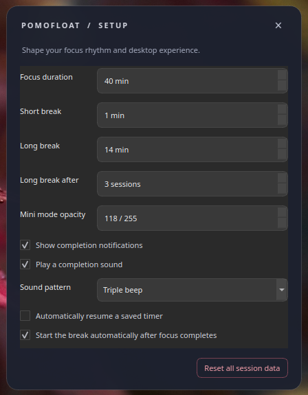
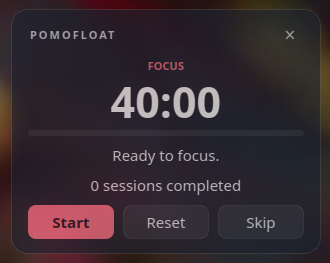
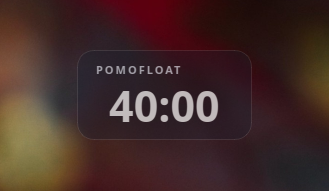

# Pomofloat

Pomofloat is a small, distraction-free Pomodoro timer for Linux desktops. It
stays visible above normal windows, lives in the system tray, and keeps the
focus/break cycle out of your way.





## Highlights

- Focus, short-break, and configurable long-break cycles.
- Monotonic-clock timing that avoids UI-refresh drift.
- Tray controls, desktop notifications, optional completion sounds, and
  keyboard shortcuts (`Ctrl+Space`, `Ctrl+R`, `Ctrl+M`, `Ctrl+Q`).
- Compact transparent mode, configurable opacity, and saved preferences.
- Frameless, draggable, always-on-top UI with the bundled icon.
- Wayland-aware startup: an explicit `QT_QPA_PLATFORM` is always respected.



## Quick start

```sh
python3 -m venv .venv
.venv/bin/python -m pip install -e .
.venv/bin/python -m pomofloat
```

Check the installed version without starting Qt:

```sh
.venv/bin/pomofloat --version
# pomofloat 2.1.4
```

Run the test suite with `.venv/bin/python -m pytest`.

### Wayland

Pomofloat uses XWayland on Wayland when no Qt platform was selected, preserving
the existing always-on-top behavior. To opt into native Wayland explicitly:

```sh
QT_QPA_PLATFORM=wayland .venv/bin/python -m pomofloat
```

The compositor ultimately controls stacking, so some fullscreen applications
or desktop policies can cover an always-on-top window.

## Debian package

The repository includes native Debian metadata. With `debhelper`,
`dh-python`, `python3-all`, and the distribution PySide6 runtime available:

```sh
dpkg-buildpackage -us -uc -b
```

The package is written next to the checkout. No installation is required to
build or test it.

## Contributing and support

See [CONTRIBUTING.md](CONTRIBUTING.md), [SECURITY.md](SECURITY.md), and
[CHANGELOG.md](CHANGELOG.md). Please use the issue templates for bugs and
feature requests.

Pomofloat is released under the [MIT License](LICENSE).
